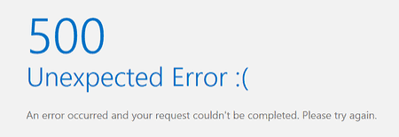

<<<<<<< HEAD
# Operació Nord Tec 
Leen Sharqawi ASIX1B

## Índex
- [Estat del projecte](#estat-del-projecte)
- [Arquitectura de xarxa](#arquitectura-de-xarxa)
- [Configuracions](#configuracions)
- [Incidències i solucions](#incidències-i-solucions)
- [Decisions tècniques](#decisions-tècniques)
- [Reflexions tècniques](#reflexions-tècniques)

## Estat del projecte
| RA | Estat |
| :--- | :--- |
| **RA1** | 🟢 Completa |
| **RA2** | 🔴 Pendent |
| **RA3** | 🔴 Pendent |

## Arquitectura de xarxa

## Configuracions
A la màquina R/firewall he configurat aquestes IPs, després a les màquines desktop i server d'Ubuntu he afegit la IP corresponent:
- Ubuntu desktop: 192.168.20.20, ruta: 192.168.20.1
- Ubuntu server: 192.168.10.10, ruta: 192.168.10.1
- He fet ping en cada màquina a la seva ruta i al 8.8.8.8 i ha funcionat.

network:
  version: 2
  ethernets:
    enp1s0:
      dhcp4: true
    enp2s0:
      dhcp4: true

    #kali
    enp3s0:
      dhcp4: false
      addresses:
        - 10.0.0.1/24  

    #dmz
    enp4s0:
      dhcp4: false
      addresses:
        - 192.168.10.1/24
        
    #lan
    enp5s0:
      dhcp4: false
      addresses:
        - 192.168.20.1/24

## Incidències i solucions

- Quan: fase i context.
- Causa: per què passava.
- Solució: què vam fer.
- Detectada per: @usuari
- Decisions tècniques (què heu triat, per què, alternatives)
=======
# Operació Nord Tec 
Leen Sharqawi ASIX1B

## Índex
- [Estat del projecte](#estat-del-projecte)
- [Arquitectura de xarxa](#arquitectura-de-xarxa)
- [Configuracions](#configuracions)
- [Incidències i solucions](#incidències-i-solucions)
- [Decisions tècniques](#decisions-tècniques)
- [Reflexions tècniques](#reflexions-tècniques)

## Estat del projecte
| RA | Estat |
| :--- | :--- |
| **RA1** | 🟢 Completa |
| **RA2** | 🔴 Pendent |
| **RA3** | 🔴 Pendent |

## Arquitectura de xarxa

## Configuracions

## Incidències i solucions

- Quan: fase i context.
- Causa: per què passava.
- Solució: què vam fer.
- Detectada per: @usuari
- Decisions tècniques (què heu triat, per què, alternatives)
>>>>>>> 4370bed8c585314898321f376321365ec72ec913
- Reflexions tècniques